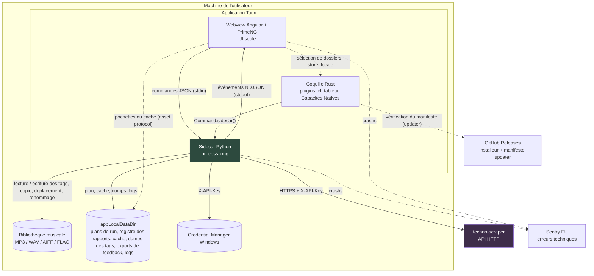
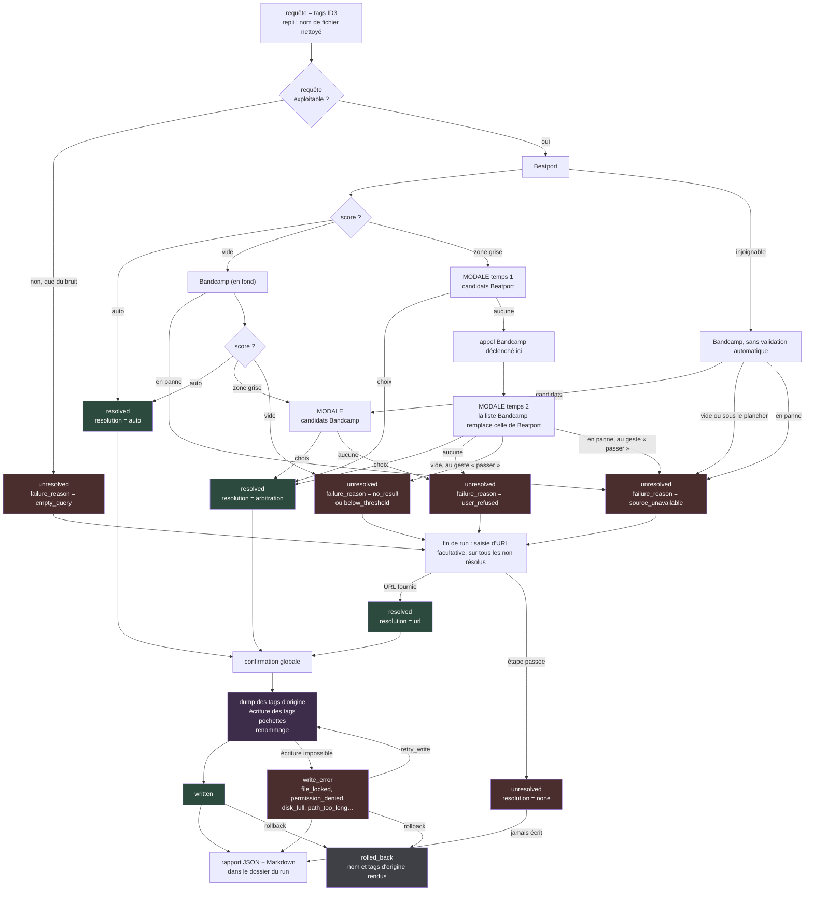
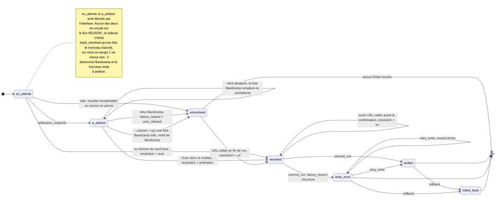
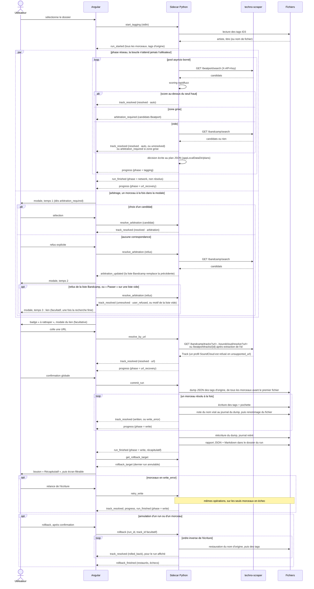

# 🧭 Contexte Projet

## Objectif

Automatiser deux corvées de la préparation d'un set DJ : extraire d'une grosse bibliothèque les morceaux d'une playlist pour les isoler dans un dossier de travail et remplacer leurs métadonnées par des données propres issues de Beatport et Bandcamp.

Le projet remplace la CLI Python mono-utilisateur `BeatportScrapper-TrackTagger` (dépôt supprimé le 2026-10-28) en la modernisant, l'optimisant et la rendant distribuable. Pain points et périmètre des features : [BRAINSTORM.md](BRAINSTORM.md).

## Type de Projet

Application desktop mono-utilisateur, sans serveur ni port ouvert. Trois couches sur la machine de l'utilisateur : webview Angular, coquille Tauri, sidecar Python. Consommatrice de l'API [techno-scraper](https://techno-scraper.empiricmind.fr) déployée en prod.

## Enjeux & Contraintes

- **Charge** : un run type traite 100 morceaux. Le débit est tenu par techno-scraper, pas par l'application ; le pool de concurrence doit rester borné pour ne pas la saturer.
- **Intégrité des fichiers** : aucun fichier n'est modifié avant confirmation globale, les tags d'origine sont sauvegardés avant réécriture et la phase d'écriture est testable sans réseau ni interface.
- **Sécurité** : la clé `X-API-Key` ne transite jamais par la webview, elle vit dans le sidecar et est stockée dans le trousseau de l'OS.
- **Vie privée** : la remontée d'erreurs est active d'office, mais le SDK est durci pour que rien de personnel n'y transite. Aucun titre de morceau ne part sans un geste manuel. Choix produit, pas contrainte réglementaire : l'outil est personnel et non commercialisé.
- **Budget** : nul. Plan gratuit Sentry, GitHub Releases, VPS déjà payé pour l'API.
- **Équipe** : 1 personne, aucune deadline.
- **Packaging** : PyInstaller ne cross-compile pas, chaque plateforme impose son runner CI. Windows seul au MVP.
- **Scalabilité** : sans objet, application locale mono-utilisateur, aucun multi-tenant.

## Public Cible

L'auteur et quelques amis DJ. Aucune ambition commerciale, aucun compte, aucune facturation.

---

# 🏗️ Architecture Globale

## Architecture : Approche Générale

Application desktop à trois couches, avec séparation stricte des responsabilités et une frontière explicite entre l'interface et le métier.

| Couche | Rôle |
|---|---|
| Angular + PrimeNG | Interface seule : sélection de dossiers, listes, modales d'arbitrage, progression, récapitulatif |
| Sidecar Python | Tout le métier : lecture/écriture des tags, appels à techno-scraper, scoring, déplacement de fichiers, plan de run |
| Tauri / Rust | Colle uniquement : `Command.sidecar()`, permissions, packaging, updater |

La frontière UI ↔ métier est un protocole NDJSON sur les flux standard, traité comme une petite API testable en ligne de commande sans interface (cf. [ADR-005](adrs/005-sidecar-python-protocole-ndjson.md)).

## Organisation du Code

### Type de Repo

Monolithe. Dépôt unique `techno-tagger`, trois zones : `src/` (Angular), `sidecar/` (Python), `src-tauri/` (Rust). Pas de workspace, pas de packages partagés : les types TypeScript du contrat NDJSON sont maintenus à la main en miroir des modèles Python, gardés par un test de cohérence côté sidecar (`test_protocol_mirror.py`).

### Package Manager

Un par zone, aucun outil de workspace transverse. **pnpm** côté Angular, supporté nativement par Angular CLI (`ng new --package-manager pnpm`, champ `packageManager` d'`angular.json`) : store global partagé, installation plus rapide et résolution stricte, dans le même esprit qu'uv côté Python. Aucun réglage particulier n'est nécessaire, en particulier pas de `node-linker=hoisted`.

### Apps & Packages

| Nom | Chemin | Rôle | Package Manager |
|-----|--------|------|------------------|
| `techno-tagger-ui` | `src/` | Interface Angular, aucune logique métier | pnpm |
| `tagger` | `sidecar/` | Métier complet, binaire PyInstaller | uv |
| `techno-tagger` | `src-tauri/` | Coquille Tauri, initialisation des plugins | cargo |

### Arborescence

```
techno-tagger/
├── src/                                  # Angular : UI uniquement
│   ├── app/
│   │   ├── core/                         # singletons et état, sans écran : sidecar (flux NDJSON, types miroir du contrat), stores (un par domaine du contrat), platform (fenêtre, thème, préférences, mise à jour), i18n, observability
│   │   ├── shared/                       # wrappers de composants (cf. DESIGN.md § Mapping Composants) et utilitaires d'affichage sans état
│   │   ├── features/                     # un dossier par onglet : playlist/, tagging/ (run, arbitrage, rattrapage par URL, récapitulatif), settings/
│   │   └── demo/                         # shell de la démo, build `demo` seul
│   ├── assets/icons/                     # SVG Simple Icons : beatport, bandcamp, soundcloud, vlc
│   ├── fixtures/                         # événements du contrat et stubs de services partagés par les specs, hors build
│   ├── demo/                             # généré par `just record-demo` : scenario.json et artworks/*.svg, servis par le seul build `demo` (cf. ADR-023)
│   ├── main.ts, main.demo.ts             # points d'entrée, Sentry dans le premier seulement
│   └── styles.css                        # CSS pur, jamais SCSS
├── public/                               # servi à la racine : logo.png, i18n/ (JSON ngx-translate)
│
├── sidecar/                              # le métier Python
│   ├── pyproject.toml, uv.lock
│   ├── src/tagger/                       # __main__.py (boucle), protocol.py (contrat), handlers.py, translation.py et un package par étape du pipeline : core, playlists, resolution, tags, run, reports (cf. § Backend > Structure du Code)
│   ├── tests/                            # unit/ (un sous-dossier par package), integration/, fixtures/, helpers/ (dont le catalogue fictif de la démo)
│   ├── tagger.spec, build.py             # PyInstaller : hidden imports, binaire
│   └── demo.py, record_demo.py           # bibliothèque de démonstration hors dépôt ; réenregistrement de src/demo/ (Windows seulement)
│
├── src-tauri/
│   ├── binaries/                         # sidecar `tagger-x86_64-pc-windows-msvc.exe` (suffixe target-triple OBLIGATOIRE) et `_internal/` (deps PyInstaller --onedir, bundle.resources)
│   ├── capabilities/default.json         # permissions
│   ├── src/lib.rs                        # init des plugins, rien d'autre (main.rs est généré)
│   ├── tauri.conf.json                   # bundle.externalBin, frontendDist, assetProtocol
│   └── installer-hooks.nsh               # hook NSIS : tue le sidecar avant l'écrasement par l'installeur
│
└── Justfile                              # recettes dev, qualité, build
```

> **Le code Rust est une zone morte, la configuration Tauri non.** Seul `src-tauri/src/` (soit `main.rs` et `lib.rs`) est figé : on y colle l'initialisation des plugins et on n'y retourne jamais. Toute logique qui s'y installerait serait à réécrire au premier changement de coquille et échapperait aux tests Python comme aux tests Angular. Le reste de `src-tauri/` se modifie régulièrement, `tauri.conf.json` pour `externalBin` et l'updater, `capabilities/default.json` pour les permissions, `binaries/` qui reçoit le sidecar à chaque build. Tout le code applicatif, lui, vit dans `src/` et `sidecar/`.

## Composants Principaux (Haut Niveau)

- **Frontend** : desktop, webview système pilotée par Tauri v2, Angular + PrimeNG
- **Backend** : sidecar Python, process long local, protocole NDJSON sur stdin/stdout, aucun port réseau
- **Données** : aucune base. Plan de run JSON, cache disque, rapports JSON + Markdown
- **Processing** : pool asyncio borné dans le sidecar, plusieurs morceaux en vol simultanément
- **Sécurité** : clé `X-API-Key` dans le trousseau de l'OS via keyring, jamais exposée au JavaScript
- **Intégrations Externes** : techno-scraper (seule source de données), Sentry (erreurs techniques), GitHub Releases (distribution et updater)

## Diagrammes d'Architecture



## Flux Fonctionnels (Use-cases critiques)

### Use-case 1 : Extraction sélective par playlist

L'utilisateur choisit un dossier source (parcouru récursivement), un dossier destination et un fichier de playlist (SQLite `vlc_media.db` ou M3U8). Le dump VLC contenant toute la médiathèque, le sidecar en liste d'abord les playlists avec leur nombre de morceaux et l'utilisateur choisit dans un sélecteur ; le schéma est vérifié avant tout traitement (cf. [ADR-019](adrs/019-resilience-schema-vlc-media-db.md)).

Le sidecar résout ensuite chaque entrée **par nom de fichier, jamais par chemin** : le chemin stocké dans la playlist est ignoré, seul le nom est cherché récursivement dans le dossier source. Sans ça le cas principal ne marche pas, la base venant du téléphone Android quand les fichiers sont sur le PC. Les morceaux trouvés sont copiés (défaut) ou déplacés vers la destination, les absents sont logués et le traitement continue. Quand plusieurs fichiers portent le même nom, le plus volumineux est retenu et les candidats écartés sont consignés (cf. [ADR-020](adrs/020-doublons-noms-de-fichiers.md)). Un **rapport d'extraction** est écrit dans le dossier destination, distinct du rapport de run que produit le re-tagging.

### Use-case 2 : Pipeline de re-tagging

L'utilisateur choisit un dossier, typiquement la destination du use-case 1. Pour chaque fichier, la requête est construite depuis les tags ID3 artiste et titre, avec repli sur le nom de fichier nettoyé, ce qui couvre aussi bien les fichiers déjà à peu près taggés que les téléchargements sauvages nommés `track01.mp3`. Le sidecar interroge techno-scraper en pool asyncio borné, score les candidats avec rapidfuzz et classe chaque morceau en **auto**, **zone grise** ou **vide**. Le pipeline ne s'arrête jamais : les morceaux ambigus s'empilent dans une file d'arbitrage traitée en parallèle du réseau.

**Seuils** : un plancher sous lequel le candidat est écarté (70 sur le score artiste et sur le score titre pris séparément au départ), un seuil haut au-dessus duquel la validation est automatique (90 sur leur moyenne au départ), zone grise entre les deux. Valeurs héritées de la CLI, réglables dans les Réglages, section Matching : `start_tagging` accepte des seuils et l'événement `version` porte ceux que le sidecar applique sans eux (`default_thresholds`), seule source des valeurs de départ.

> **Hérités ne veut pas dire transposables** : le contrat de sortie de l'API a changé, 70 et 90 sont à recalibrer aux premiers runs réels (cf. [ADR-008](adrs/008-matching-rapidfuzz-et-agent-ia.md)).

**Scoring** : chaque artiste demandé se compare un à un aux crédits du candidat et le plus faible l'emporte (un artiste absent n'est pas racheté par les autres), titre et version se comparent séparément, un candidat sans mention de remix est écarté quand la requête en contient une, et une version ou un nombre du titre qui diffère interdit la validation automatique sans écarter le candidat. Le candidat est comparé tel que techno-scraper le rend (titre sans version ni invité, version dans `mix_name`, crédits découpés), sans redécoupage côté sidecar (cf. [knowledges/techno-scraper.md](knowledges/techno-scraper.md)). Règles complètes : `resolution/matching.py` et la [spec du sub-project 03](superpowers/specs/onglet-scraping-pipeline-de-re-tagging/03-requete-et-scoring-design.md).

**Nettoyage de la requête** : il s'applique à la chaîne interrogée, jamais aux tags du fichier, et son motif porte sur le contenu, pas sur le délimiteur. Un groupe entre parenthèses ne quitte que la chaîne envoyée à techno-scraper et reste dans le titre comparé comme version : un groupe libre comme un nom de label envoie donc le morceau en zone grise plutôt que de laisser l'original valider seul.

> **Garde absolue** : un groupe contenant une **mention de version** (remix, edit, dub, rework…) ou de **collaboration** (`feat.`, `with`, `vs.`…) n'est jamais retiré. `(Adam Beyer Remix)` et `feat. Roisin Murphy` **identifient le morceau** : Beatport traite le featuring comme un artiste à part entière et supprimer une mention de version casserait la règle de scoring ci-dessus. Cette garde contraint donc deux modules, le nettoyage et le scoring. Une version absente de la liste disparaîtrait de la recherche : la liste vit dans le code.

### Use-case 3 : Arbitrage utilisateur

Dès qu'un morceau entre en zone grise et qu'aucune modale n'est ouverte, la modale s'affiche avec les seuls candidats en zone grise et leur score. Un refus explicite déclenche l'appel Bandcamp, dont la liste **remplace celle de Beatport dans la même fenêtre**. Bandcamp n'est jamais appelé spéculativement (cf. [ADR-009](adrs/009-enchainement-sources-et-arbitrage.md)). Navigation entre arbitrages en attente par flèches avec compteur.

### Use-case 4 : Rattrapage par URL

Dernière phase réseau, entièrement **facultative**. Une fois le pipeline terminé, l'utilisateur peut coller une URL Beatport, Bandcamp ou SoundCloud sur chaque morceau resté non résolu, quelle qu'en soit la cause. C'est le seul point d'entrée de SoundCloud, dont les métadonnées d'upload sont trop peu fiables pour une recherche automatique.

L'URL se colle dans la modale du lien, ou dans l'étape lien qui suit le refus de tous les candidats d'un arbitrage (cf. [DESIGN.md](DESIGN.md)). Elle est résolue via la route correspondante de l'API, avec sa propre barre de progression. **Les trois sources n'ont pas la même voie** : Bandcamp et SoundCloud résolvent l'URL directement, Beatport n'expose pas de résolution par URL et impose d'extraire l'identifiant du morceau de l'URL collée pour appeler la route par id.

**Morceaux éligibles** : un morceau `unresolved` accepte une URL, un morceau déjà résolu par URL aussi (recoller remplace l'URL précédente, pour corriger un mauvais lien avant l'écriture). Les morceaux résolus automatiquement, par arbitrage, en attente d'arbitrage ou jamais traités n'en acceptent pas. Le sidecar calcule cette éligibilité et l'envoie dans `recoverable` (cf. § API). Un morceau rattrapé n'a pas de score.

### Use-case 5 : Écriture et renommage

**Le point de non-retour du run** et la seule phase qui touche aux fichiers musicaux. Déclenchée par la confirmation globale, jamais avant (cf. [ADR-010](adrs/010-ecriture-batch-et-plan-de-run.md)).

Le dump JSON des tags d'origine de tous les morceaux visés précède le premier fichier touché. Puis, morceau par morceau : écriture des tags avec la pochette, puis renommage. Le renommage vient toujours en dernier : il ne s'applique qu'à un morceau dont les tags sont écrits et calcule le nom depuis la projection écrite, sans rouvrir le fichier. Le nom visé est noté au journal du dump, sur le disque, avant que le fichier ne bouge. L'ensemble dure quelques secondes, les pochettes ayant été téléchargées pendant la phase réseau.

Le motif est `{artist} - {title}.{ext}`, non configurable au MVP : caractères interdits remplacés de façon lisible, extension en minuscules, aucun renommage sans artiste ou sans titre, collision suffixée ` (2)`, ` (3)`… sans jamais écraser un fichier (règles : [spec du renommage](superpowers/specs/ecriture-des-tags-et-renommage/03-renommage-fichiers-design.md)).

Un fichier en échec n'interrompt jamais la phase : il est consigné et l'écriture se poursuit sur les suivants (cf. § [Robustesse](#%EF%B8%8F-robustesse--modes-de-panne)). Le run se termine par l'écriture du rapport dans le dossier du run. Le récapitulatif filtrable s'ouvre ensuite par le bouton « Récapitulatif » de l'onglet Tagging.

### Use-case 6 : Reprise d'un run interrompu

Chaque décision est écrite au fil de l'eau dans un plan JSON dans `appLocalDataDir()`. Au lancement, `get_interrupted_run` annonce le plan non confirmé le plus récent et l'application propose de reprendre (`resume_run`) ou de repartir de zéro (`discard_run`). Aucun fichier n'a été touché entre-temps, la reprise est donc sans risque.

La reprise rejoue les décisions et les arbitrages en attente, sans rappeler l'API, puis ne relance que les morceaux sans décision, ceux restés en `source_unavailable` compris. Elle repart des seuils du plan et garde son fichier. Deux cas ne laissent que « repartir de zéro » : un plan d'une autre version ou illisible, jamais migré ([ADR-018](adrs/018-versionnement-plan-de-run.md)), et un dossier introuvable ou vidé de ses fichiers audio, que « Plus tard » laisse à un disque rebranché.

## Chaîne de résolution d'un morceau



Trois états après interrogation d'une source : **auto** (un candidat au-dessus du seuil haut), **zone grise** (candidats plausibles, décision humaine), **vide** (zéro résultat ou tout sous le plancher). Zéro résultat, candidats sous le plancher et refus utilisateur convergent tous vers **un seul `state`**, `unresolved`, le paquet que la phase URL rattrape. Leur `failure_reason` continue de les distinguer dans le rapport, la correction à apporter n'étant pas la même selon le motif.

**Beatport injoignable** : une fois les nouvelles tentatives du client épuisées, ou sur une réponse hors contrat, Bandcamp est interrogé, mais tout ce qu'il trouve part en zone grise, jamais en validation automatique. Si Bandcamp échoue aussi, ou ne rend aucun candidat retenu (liste vide ou tout sous le plancher), le morceau part en `unresolved` / `source_unavailable`, rejoué à la reprise : Beatport n'ayant rien dit, `no_result` et `below_threshold` seraient des constats définitifs (cf. [ADR-009](adrs/009-enchainement-sources-et-arbitrage.md)).

**Liste Bandcamp vide après un refus** : le morceau reste à arbitrer, la modale affichant la liste vide, jusqu'au geste « passer ». Il part alors en `unresolved` avec le motif de Bandcamp (`no_result`, `below_threshold` ou `source_unavailable`), jamais `user_refused` : la correction à apporter est celle de Bandcamp. Après un refus, Bandcamp ne valide jamais seul, l'utilisateur étant en train de décider.

## Patterns Utilisés

- **Séparation UI / métier par protocole** : la frontière n'est pas un appel de fonction mais un contrat de messages, ce qui rend le métier testable en ligne de commande et l'UI remplaçable
- **Event streaming unidirectionnel** : commandes de l'UI vers le sidecar, flux d'événements du sidecar vers l'UI, jamais de requête/réponse synchrone bloquante
- **Write-ahead planning** : les décisions sont persistées avant l'effet de bord, jamais l'inverse, ce qui rend la reprise triviale et le crash inoffensif
- **Cache jetable** : le dossier de cache peut être supprimé à tout moment sans rien casser, seulement des appels réseau à repayer
- **Anti-corruption layer** : `scraper_client.py` isole le contrat de techno-scraper du reste du métier, un changement d'API ne touche qu'un fichier

---

# 🌐 Architecture Technique

## 🎨 Frontend

### Framework

**Angular 22**, webview système pilotée par **Tauri v2**. Angular est déjà maîtrisé et Next.js n'apporterait rien sans serveur Node (cf. [ADR-002](adrs/002-framework-ui-angular.md)).

Angular 22 fait d'**OnPush la stratégie de détection de changement par défaut** pour les composants qui n'en déclarent pas. Sans incidence ici : l'état passe par des signals et ngx-translate documente la compatibilité OnPush de son pipe et de sa directive.

### Styling & UI

- **Bibliothèque de composants** : **PrimeNG v22**, sous Community License gratuite, valable 12 mois avec 30 jours de grâce et renouvelable sans frais. Aucune limitation fonctionnelle sur la bibliothèque centrale ; le Theme Designer n'est pas inclus, toute personnalisation passe par `definePreset()` (cf. [ADR-003](adrs/003-primeng-community-license.md))
- **Preset** : **Aura**, import `@primeuix/themes/aura` (base 16px, pas la variante `-compat`)
- **Mode sombre par défaut**, forcé via `darkModeSelector` dans `providePrimeNG()` et une classe posée sur `<html>`. Cohérent avec les outils DJ (Rekordbox, Traktor, Serato) et avec un usage nocturne. Aucun sélecteur clair/sombre à maintenir au MVP.
- **Table à scroll virtuel** PrimeNG, à sa taille par défaut, pour les listes de 100 lignes et le tableau récapitulatif filtrable
- **Styling utilitaire** : **Tailwind CSS v4** avec le plugin officiel **`tailwindcss-primeui`**, qui expose les design tokens du preset en classes. L'alignement du variant `dark:` sur le `darkModeSelector` reste une ligne à écrire dans le CSS global. PrimeNG livre les composants, Tailwind couvre le layout et l'espacement qui restent à écrire. Contrainte à connaître : **Tailwind v4 ne compile ni SCSS ni LESS**, tout le styling du projet est donc en CSS pur
- **Typographie** : **Inter**, paquet `@fontsource-variable/inter` embarqué dans le bundle. Aucun CDN de polices, l'application devant s'afficher identiquement hors ligne. Le preset Aura ne déclare aucune `font-family`
- **Icônes** : **`@primeicons/angular`**, tiré par PrimeNG v22, qui rend des composants standalone en SVG inline et non plus une police avec des classes `pi pi-*`. S'y ajoutent des SVG **Simple Icons** dans `src/assets/icons/` pour les logos Beatport, Bandcamp, SoundCloud et VLC, absents du jeu

Le détail (tokens, scale typographique, mapping composant par composant, conventions de style et anti-patterns) vit dans [DESIGN.md](DESIGN.md).

### State Management

**Services injectés + signals natifs Angular**, aucune bibliothèque de store. `SidecarService` est la frontière unique avec le sidecar (transport, version, erreurs) : il route chaque événement du contrat vers le store de son domaine, dans `core/stores/`, et re-expose leurs signals.

- **`TaggingRunStore`** : liste du run et progression de la phase réseau
- **`ArbitrationStore`** : file des arbitrages
- **`UrlRecoveryStore`** : phase de rattrapage, ouverte à la première progression `url_recovery` reçue et jamais déduite par l'interface
- **`WriteStore`** : confirmation, progression, fin, rollback en cours, bilan et dernier run annulable, redemandé après chaque écriture et chaque restauration
- **`ResumeStore`** : run interrompu à proposer au lancement
- **`PastRunsStore`** : runs passés relisibles, celui que le récapitulatif a rouvert, chargement en cours et refus de `load_run` avec son run

`CloseGuard` refuse la fermeture pendant une écriture ou une restauration, Tauri arrêtant le sidecar à la sortie, et demande confirmation pendant une extraction. `RecoveryUiStore` (`features/tagging/url-recovery/`) porte le seul état propre à l'interface (liens collés, modale ouverte), sans rien du sidecar. Les composants ne font que lire et émettre des commandes.

Trois écrans et des stores à signals ne justifient pas la cérémonie d'un NgRx.

### Navigation

**Angular Router**, trois onglets lazy-loaded (`/playlist`, `/tagging`, `/settings`) rendus dans un `p-tabs`, l'onglet Tagging portant aussi `/tagging/recap`, le récapitulatif du run affiché, et `/tagging/recap/:runId`, celui d'un run passé, ouvert en lecture seule depuis la rangée « Runs passés » des Réglages. Le lazy-loading évite de charger les trois features au démarrage.

PrimeNG v22 ne fournit **aucun mode router** sur `p-tabs` et `p-tabMenu` a été supprimé de la bibliothèque. L'onglet actif se dérive donc de l'URL et la navigation se déclenche au changement de valeur, soit une dizaine de lignes dans le shell (cf. [DESIGN.md § Mapping Composants](DESIGN.md#mapping-composants)).

**La barre d'onglets est la barre de titre** (`decorations: false`) : logo et nom à gauche, Playlist et Tagging au centre, Réglages en engrenage, puis les badges (arbitrages, liens à coller, mise à jour) et les boutons de fenêtre (`WindowControlsComponent`) à droite. `data-tauri-drag-region` couvre ce qui n'est pas un contrôle. L'écran bloquant (sidecar absent ou en conflit de version) porte la même barre : sans elle, la fenêtre ne se déplacerait ni ne se fermerait.

### Capacités Natives

Plugins Tauri v2 enregistrés dans `src-tauri/src/lib.rs`, permissions dans `src-tauri/capabilities/default.json` :

| Plugin | Usage |
|---|---|
| `shell` | Lancement du sidecar via `Command.sidecar()`. Permission `shell:allow-spawn` (process long) et non `shell:allow-execute`, ciblant le sidecar (`"sidecar": true`) : aucune commande arbitraire n'est autorisée. `shell:allow-stdin-write` laisse passer les commandes NDJSON |
| `dialog` | Sélection des dossiers source, destination et du fichier de playlist |
| `core` (fenêtre) | Barre de titre maison (`decorations: false`) : réduire, agrandir (double-clic de la barre compris), déplacer, fermer. `close` repasse par la garde de sortie (`CloseGuard`), `destroy` ferme sans la repasser. `allow-start-dragging` et `allow-internal-toggle-maximize` sont absents de `core:default` : sans eux la barre ne déplace rien, sans erreur visible |
| `store` | Préférences : mode copie / déplacement, signal sonore, dernière destination, langue (`null` tant que rien n'est choisi), seuils (l'écart aux défauts du sidecar, `null` sinon). L'URL de l'API n'y figure pas : c'est une constante du sidecar, seul à appeler techno-scraper (cf. [ADR-012](adrs/012-securite-cle-api-keyring.md)) |
| `os` | Lecture de la locale système au premier lancement (`locale()`, format BCP-47) |
| `opener` | Fiche source d'un morceau, dossier des logs, issue de retour du récapitulatif et révélation de son export. En Tauri v2, ouvrir un chemin ou une URL a quitté `shell` pour ce plugin, que la permission `shell` restreinte au sidecar ne couvre pas |
| `single-instance` | Un second lancement donne le focus à la fenêtre existante. Deux fenêtres signifieraient deux sidecars écrivant le même plan de run (cf. § [Robustesse](#%EF%B8%8F-robustesse--modes-de-panne)) |
| `updater` | Vérification du manifeste de la Release au démarrage, téléchargement et installation signés. Clé publique dans `tauri.conf.json`, artefacts signés en CI seule (cf. [PRODUCTION.md § Code Signing](PRODUCTION.md#code-signing)) |
| `prevent-default` | Plugin tiers, sans permission ni paquet npm. Coupe en release le rechargement, le menu contextuel, l'ouverture d'un fichier et l'affichage du source : un rechargement relancerait le sidecar sans arrêter le précédent, qui poursuivrait un run que l'interface a oublié. Le debug garde tout pour le live reload |

Deux réglages ne passent pas par un plugin :

- **`app.security.assetProtocol`** dans `tauri.conf.json`, `enable: true` plus un `scope` restreint au dossier de cache. Sans lui, la webview ne peut pas afficher les pochettes lues sur le disque, que le sidecar ne transporte jamais en base64 dans le flux NDJSON (cf. [DESIGN.md § Mapping Composants](DESIGN.md#mapping-composants)).
- **La fenêtre**, dans `tauri.conf.json` : `decorations: false` (la barre d'onglets fait barre de titre, cf. § Navigation), 1280 × 800 à l'ouverture, plancher 1024 × 700 dicté par le jeu de colonnes de la liste d'un run (cf. [DESIGN.md § Layout](DESIGN.md#-layout--espacement)), sans plafond. La taille **n'est pas mémorisée** entre deux lancements : le plugin `window-state` la mémoriserait, il n'est pas retenu au MVP.

### Structure du Code

`core/` pour ce qui vit sans écran, `features/` pour les trois onglets, `shared/` pour ce que plusieurs onglets affichent (cf. § Arborescence). Aucune logique métier côté Angular : le calcul des scores, la construction des requêtes et les règles d'écriture vivent dans le sidecar. Les seuls accès aux plugins Tauri (`PreferencesService`, `NativeService`, `APP_UPDATER`, `APP_WINDOW`) sont regroupés dans `core/platform/`, ce qui les rend remplaçables en test.

### i18n

**ngx-translate**, français et anglais, bascule à l'exécution sans rebuild (cf. [ADR-004](adrs/004-i18n-ngx-translate.md)). Au premier lancement, la locale système décide : commence par `fr` donne du français, tout le reste donne de l'anglais. Le sélecteur des Settings force ensuite l'une ou l'autre : le choix, enregistré dans le `store` au seul geste de l'utilisateur, prime sur la locale aux lancements suivants.

### Services Externes

**@sentry/angular**, erreurs de la webview uniquement, SDK durci (cf. § Observabilité).

## 💻 Backend

### Runtime & Langage

**Python**, empaqueté en binaire autonome par **PyInstaller**. L'interpréteur et toutes les dépendances sont embarqués : aucune installation de Python n'est requise chez l'utilisateur.

### Framework

**Aucun**. Le sidecar n'est pas un serveur : `__main__.py` lit des commandes JSON ligne par ligne sur `stdin` et émet des événements NDJSON sur `stdout`. Pas de FastAPI, pas de port ouvert, pas de surface réseau entrante. **Pydantic ne fait pas exception à cette règle** : il ne sert pas de framework, seulement de brique de validation des modèles décrits ci-dessous.

### Structure du Code

Modules à responsabilité unique sous `src/tagger/`, sans framework ni couche d'injection. `protocol.py` définit les modèles **Pydantic** (cf. [ADR-022](adrs/022-modeles-pydantic-du-protocole.md)) de commandes et d'événements et constitue la seule interface publique du sidecar ; tout le reste est appelé depuis la boucle de `__main__.py`.

Les modules sont regroupés en **packages par étape du pipeline**, dans l'ordre où un run les traverse. Chaque package n'importe que ceux listés avant lui, ce qui interdit les cycles : `core` ← `playlists` ← `resolution` ← `tags` ← `run` ← `reports`. À la racine, `protocol.py` décrit le contrat et aucun package ne l'importe, `translation.py` projette l'état d'un run sur ce contrat, `handlers.py` exécute les commandes et voit tout.

Quelques modules portent une règle d'architecture, le reste se lit dans le code :

- **`resolution/scraper_client.py`** : seul à connaître le contrat de techno-scraper (anti-corruption layer)
- **`core/models.py`** : base immuable et fermée (`extra="forbid"`) des modèles écrits sur le disque, un champ inconnu signalant un fichier d'une autre version ou corrompu
- **`core/run_files.py`** : écriture atomique (durable sur demande, `fsync` avant le remplacement), lecture versionnée et rétention, partagées par dumps, plans, rapports et exports de feedback
- **`core/identifiers.py`** : `RunId` et `TrackId` nominaux, une permutation d'identifiants casse au typage
- **`run/gestures.py`** : un seul geste en vol par morceau, le second refusé et jamais mis en file, règle commune à l'arbitrage et au rattrapage

### API

**Protocole NDJSON bidirectionnel** sur les flux standard : commandes JSON une par ligne sur `stdin`, événements NDJSON sur `stdout`. Le sidecar est un process long lancé au démarrage de l'application, pas une invocation par action, ce qu'imposent la barre de progression et le pipeline qui continue de tourner pendant qu'une modale attend une décision (cf. [ADR-005](adrs/005-sidecar-python-protocole-ndjson.md)).

**Source de vérité : `protocol.py`.** Les types TypeScript de `core/sidecar/protocol.ts` en sont le miroir maintenu à la main, gardé par `test_protocol_mirror.py`. Cette section ne recopie pas le contrat, elle fixe les règles qui le gouvernent.

- **Commandes** : session (`get_version`, `shutdown`, `set_api_key`), phases longues (`extract_playlist`, `start_tagging`, `resume_run`, `commit_run`, `retry_write`, `rollback`), gestes du run (`resolve_arbitration`, `switch_arbitration_source`, `resolve_by_url`, `cancel_run`), lectures et administration (`list_playlists`, `get_interrupted_run`, `discard_run`, `get_rollback_target`, `list_runs`, `load_run`, `get_cache_size`, `clear_cache`, `prepare_feedback`)
- **Événements** : `version` et `progress` ; le fil d'un run (`run_started`, `track_resolved`, `arbitration_required`, `arbitration_updated`, `run_finished`) ; une réponse par lecture (`playlists_listed`, `extraction_finished`, `interrupted_run`, `runs_listed`, `run_loaded`, `rollback_target`, `rollback_finished`, `cache_size`, `cache_cleared`, `feedback_ready`) ; `error`
- **Refus hors état** : une commande qui n'est pas acceptable dans l'état courant (phase longue en cours, run pas encore ouvert à l'écriture, run déjà confirmé, geste déjà en vol sur le morceau) rend un `error` à code stable, jamais un effet de bord partiel. Codes et conditions : `protocol.py` et les specs
- **`version`** : première réponse de tout lancement. Version du sidecar nue (`X.Y.Z`), comparée à celle de l'interface avant tout run (cf. [PRODUCTION.md](PRODUCTION.md#remplacement-du-sidecar-à-la-mise-à-jour)) ; `api_key_configured` (seul le sidecar lit le trousseau, cf. [ADR-012](adrs/012-securite-cle-api-keyring.md)) ; `default_thresholds` ; `log_file`

**`error` nomme la commande qui a échoué, l'interface ne la déduit pas.** Une commande courte émise pendant un run récupérerait sinon l'échec du run, `start_tagging` rendant la main aussitôt (§ [Concurrence](#concurrence)). Un écran n'affiche que les erreurs des commandes qu'il émet. Le champ vaut `null` sur une ligne trop malformée pour désigner une commande.

**Seul l'échec de la commande qui a ouvert un run le clôt** : l'interface arrête l'extraction sur une erreur portant `extract_playlist` et le run affiché sur une erreur portant `start_tagging`, et laisse courir le run sur toute autre, qui tourne toujours côté sidecar. `phase_busy` est l'exception qui confirme la règle : il refuse un lancement en affirmant qu'une phase continue, et `params.phase` nomme cette phase, pas la commande refusée. Aucun geste d'arbitrage ni de rattrapage ne reçoit un `phase_busy`.

**`run_finished` porte une `phase`** (`network` après la boucle de résolution, `write` après `commit_run` ou `retry_write`) : la fin de la boucle de résolution ouvre le rattrapage par URL, la fin de l'écriture ouvre le récapitulatif, deux écrans pour un seul événement. `Phase` qualifie un `progress`, `RunPhase` un `run_finished` : elles partagent la valeur `write` sans être le même type, mypy refuse de les mélanger.

**L'état d'un morceau tient en trois champs**, jamais en une liste plate de valeurs :

| Champ | Valeurs | Rôle |
|---|---|---|
| `state` | `resolved`, `unresolved`, `written`, `write_error`, `rolled_back` | Ce que le morceau est devenu. `rolled_back` : rendu à son origine par un rollback, plus de candidat, `resolution` conservée mais masquée par l'état |
| `resolution` | `auto`, `arbitration`, `url`, `none` | La voie empruntée, d'où sortent les filtres du récapitulatif |
| `failure_reason` | Résolution : `empty_query`, `no_result`, `below_threshold`, `user_refused`, `source_unavailable`. Écriture : `file_locked`, `permission_denied`, `disk_full`, `path_too_long`, `file_missing`, `write_failed`. Rollback : `name_taken` | Le motif, exigé par le rapport qui distingue la requête vide des autres échecs (cf. § [Robustesse](#%EF%B8%8F-robustesse--modes-de-panne)) |

Un seul champ `failure_reason` sur le fil, deux enums côté sidecar (`FailureReason` pour la résolution et `name_taken`, `FileFailureReason` pour les pannes de fichier), dont un test garde les chaînes disjointes. Les motifs d'écriture se rattrapent tous par `retry_write` : c'est le motif qui change, jamais l'état ni la correction.

**`restorable` et `recoverable` sont calculés par le sidecar** et publiés sur `track_resolved` : l'interface ne les déduit jamais de `state`. `restorable` est vrai quand le dump du run porte l'origine du morceau, `recoverable` quand le morceau accepte une URL (la phase de rattrapage ouverte et le run non confirmé restent des conditions à part). Ni `run_started` ni `run_loaded` ne les portent.

**`source_unavailable` couvre tout ce qui empêche la source de répondre** : 504 après le budget de l'API, timeout client, coupure réseau. Le distinguer de `no_result` n'est pas cosmétique : le premier est définitif, le second se rejoue tel quel sur un run suivant. Un 504 n'est pas retryé dans le run, il signale une file saturée ([ADR-017](adrs/017-taille-pool-concurrence.md)).

**Un incident qui concerne un morceau ne produit jamais les deux événements.** Il sort en `track_resolved`, avec son `state` et son `failure_reason` : c'est ce que consomment la liste et les filtres du récapitulatif. L'événement `error` est réservé à ce qui ne se rattache à aucun morceau (clé invalide, dump VLC illisible, sidecar en perdition). Son `params.track_id` ne sert qu'à situer l'échec d'un geste sur sa ligne. Sans cette règle, un fichier verrouillé arriverait par deux chemins et serait compté deux fois.

**Aucun état « en attente » ni « en cours » ne circule sur le flux** : le sidecar n'émet `track_resolved` qu'une fois le morceau tranché et l'interface affiche par défaut « en attente » tout ce qu'elle n'a pas encore reçu. Après `commit_run`, `state` passe à `written` ou `write_error`, la voie de résolution restant lisible dans `resolution`. Un cas d'échec nouveau s'ajoute dans `failure_reason`, jamais comme valeur d'état de plus.



**Le filtre du récapitulatif et l'origine de la décision ne sont pas au même niveau.** Le filtre sépare ce que la machine a tranché de ce qu'un humain a décidé, l'origine dit par quel mécanisme. L'échec se lit en premier et sur `state`, les deux autres filtres se lisent ensuite sur `resolution`, ce qui les rend disjoints :

| Filtre | Vaut | Origines couvertes |
|---|---|---|
| échecs | `state ∈ {unresolved, write_error}` | Abandon et fichiers en échec d'écriture |
| validés | `state ∈ {resolved, written}` et `resolution = auto` | Score au-dessus du seuil haut, personne n'a regardé |
| arbitrés | `state ∈ {resolved, written}` et `resolution ∈ {arbitration, url}` | Choix dans la modale, **et** URL collée en fin de run |

Un morceau `rolled_back` sort des trois filtres, aucune décision ne le décrivant plus. Trois pièges cassent le récapitulatif au moment où il s'affiche :

- **« Arbitrés » en `resolution === 'arbitration'`** fait disparaître les morceaux rattrapés par URL, ceux que l'utilisateur veut justement relire
- **« Validés » ou « arbitrés » câblés sur `state`** cessent de matcher après `commit_run`, `resolved` étant devenu `written`
- **« Échecs » câblé sur `resolution`** est impossible : un `write_error` garde sa voie d'origine, il serait indiscernable d'un morceau bien écrit

Ni `unresolved` ni `write_error` ne changent au commit. Un `write_error` peut encore en sortir par `retry_write` ou `rollback` et le filtre se vide alors à l'écran : c'est voulu. Ce découpage alimente la colonne État de l'interface, dont les couleurs sont regroupées en quatre familles (cf. [DESIGN.md § Couleurs Sémantiques](DESIGN.md#couleurs-sémantiques)).

**Le sidecar n'émet jamais de phrase destinée à l'écran.** Il émet un `code` stable (`file_locked`, `api_key_rejected`, `vlc_schema_mismatch`…) et des `params` structurés (chemin, table manquante, nom du champ). L'interface traduit, via ngx-translate comme le reste des libellés. Le champ `message` reste du texte technique, écrit dans les logs, jamais affiché. Sans cette règle, l'i18n serait à maintenir en double ou les erreurs s'afficheraient dans une autre langue que le reste de l'interface.

> **La règle porte sur le flux NDJSON, pas sur les fichiers.** Les artefacts que le sidecar écrit lui-même sur le disque, rapports et logs, ne passent pas par l'interface : ils sont en **anglais**, quelle que soit la langue choisie dans les Settings (cf. § [Données](#%EF%B8%8F-données)).

Le contrat se teste en ligne de commande en injectant des commandes sur `stdin` et en lisant `stdout`, sans lancer l'interface.

### Concurrence

Pool **asyncio** borné, client **httpx2** (cf. [ADR-007](adrs/007-client-http-httpx2.md)), dimensionné en miroir des sémaphores de sortie de techno-scraper : **3 requêtes Beatport en vol, 2 pour Bandcamp, 5 pour SoundCloud**, appelé au seul rattrapage par URL, timeout client à **100 secondes**, au-dessus du budget de 90 secondes de l'API (cf. [ADR-017](adrs/017-taille-pool-concurrence.md)).

**Le téléchargement des pochettes a son propre pool**, fixé à 6 : l'`artwork_url` pointe vers le CDN de la source, le téléchargement ne passe donc pas par techno-scraper et ne consomme pas ses sémaphores. C'est un calibrage libre, aucun sémaphore distant ne le dicte, seule la politesse envers le CDN. Un échec de téléchargement n'échoue jamais le morceau : les tags sont écrits sans pochette et le rapport le signale.

**Les phases longues tournent en tâche de fond, la boucle ne les attend pas.** `extract_playlist`, `start_tagging`, `resume_run`, `commit_run`, `retry_write` et `rollback` : les attendre dans la boucle gèlerait la lecture de `stdin` et une fermeture de fenêtre pendant la copie d'une grosse bibliothèque laisserait son `shutdown` dans le pipe jusqu'au dernier transfert. **Une seule tourne à la fois** : chacune refuse de démarrer tant qu'une autre tourne, par une seule erreur, `phase_busy` (`params.phase` nomme celle qui tourne : `extraction`, `tagging`, `write` ou `rollback`), la garde précédant tout effet de bord du démarrage. Extraction, écriture et rollback touchent aux fichiers de l'utilisateur, la recherche réseau lit ceux qu'elle fera écrire : deux phases mêlées pourraient viser le même dossier. Arbitrer et rattraper restent possibles pendant la recherche, ce sont des gestes du run et non des phases longues.

**L'annulation les sépare.** `shutdown` et `cancel_run` annulent le run de re-tagging, qui ne tient que du réseau et de la mémoire, mais `shutdown` attend l'extraction, l'écriture et le rollback : une copie, une écriture ou une restauration coupée en vol laisserait un fichier musical à moitié écrit ou à moitié rendu, ce que la garantie sur la bibliothèque interdit. Seule la phase réseau est donc annulable, et la commande attend que le run annulé ait fini de mourir avant de lire la suivante : une relance lue entre-temps serait refusée en `phase_busy`.

**Le run courant survit à sa phase réseau.** `start_tagging` ouvre un run (`LiveRun`) dont la file d'arbitrage est une simple structure en mémoire, exposée à l'interface par les événements NDJSON : aucun courtier de messages, tout vit dans un seul process. Son client et son fetcher de pochettes restent ouverts après `run_finished` comme après `cancel_run`, le temps des arbitrages et du rattrapage par URL, qui partagent les sémaphores du client et la garde des 403 avec le pipeline. Ils ne se ferment qu'au run suivant, au `shutdown` ou à l'EOF. Un choix ou un refus attend le réseau (refetch, appel Bandcamp) : il part en tâche de fond comme les phases longues, alors que `switch_arbitration_source` n'attend rien et s'exécute dans la boucle.

### Sécurité Backend

- **AuthN / AuthZ** : sans objet, application locale mono-utilisateur. Aucun compte, aucun rôle, aucun port en écoute.
- **Authentification sortante** : header `X-API-Key` vers techno-scraper, une clé par utilisateur, saisie dans les Settings et stockée via **keyring** dans le Credential Manager Windows (cf. [ADR-012](adrs/012-securite-cle-api-keyring.md))
- **Durcissement** : le plugin `shell` de Tauri n'autorise que le lancement du sidecar déclaré, pas de commande arbitraire. La webview n'a aucun accès au système de fichiers (aucun plugin `fs`) : les fichiers musicaux et les artefacts de run (plans, cache, dumps, rapports, logs) sont lus et écrits par le sidecar Python seul, la webview ne lisant que les pochettes du cache par l'asset protocol.
- **Validation** : toute commande reçue sur `stdin` est validée contre son modèle Pydantic avant exécution, `extra="forbid"` rejetant tout champ non déclaré ; une commande malformée produit un événement `error`, jamais un effet de bord partiel.
- **Requête sortante vers une adresse libre** : `release.artwork_url` est la seule valeur du contrat qui en déclenche une et le CDN de la source n'est documenté nulle part, donc aucune liste blanche de domaines. Le garde juge l'hôte sur ce qu'il résout et non sur sa forme (`https` obligatoire, toute adresse non globale refusée), puis **relit l'adresse réellement connectée** : le client HTTP refaisant sa propre résolution, un DNS qui en rend une autre entre les deux ferait sinon sonder la machine ou le réseau de l'utilisateur et les motifs d'échec suffiraient à dire ce qui y répond. Tous ces cas rendent un `blocked_url` unique. Reste hors de portée la connexion TCP elle-même, qu'exclure demanderait d'épingler l'adresse validée jusque dans le transport.

### Services Externes

- **techno-scraper** : seule source de données, via le domaine public et le header `X-API-Key`. Aucun scraping dans l'application (cf. [ADR-006](adrs/006-scraping-delegue-techno-scraper.md)).
- **Sentry** (`sentry-sdk`, plan Developer gratuit, région EU) : erreurs techniques uniquement, SDK durci (cf. § Observabilité).

### Agents IA

**Post-MVP uniquement.** Orchestration **PydanticAI** dans le sidecar, aucune infrastructure distante (cf. [ADR-008](adrs/008-matching-rapidfuzz-et-agent-ia.md)). Mode désactivé par défaut ; sans clé API du fournisseur renseignée, l'application se comporte exactement comme au MVP.

## 🗄️ Données

**Aucune base de données.** Des fichiers aux durées de vie et aux emplacements distincts :

| Artefact | Emplacement | Durée de vie | Rôle |
|---|---|---|---|
| Plan de run | `appLocalDataDir()/plans` | Purgé au démarrage une fois confirmé (`commit_run`), 30 jours depuis son démarrage s'il est interrompu, même repris. Un run remplacé dans la session supprime le sien, `shutdown` et `cancel_run` le gardent | État de session, reprise |
| Cache API + artworks | `appLocalDataDir()/cache` | TTL 30 jours, plafond 500 Mo en éviction LRU | Éviter de repayer un re-run |
| Rapport d'extraction, JSON + Markdown | Dossier destination | Permanente, livrable | Titres introuvables, doublons résolus et candidats écartés |
| Rapport de run, JSON + Markdown (`tagging-report-<horodatage>`) | Dossier du run, celui de `start_tagging` et non le dossier destination | Permanente, livrable. Réécrit sous les mêmes noms à la fin de chaque relance de l'écriture, jamais après un rollback | Traçabilité, relecture par l'app, envoi de feedback |
| Registre des rapports | `appLocalDataDir()/reports.json` | Permanente, une entrée par run écrit, rapports disparus écartés à la lecture | Liste des runs passés |
| Dump des tags d'origine | `appLocalDataDir()/dumps`, un JSON par run nommé par son horodatage et son `run_id` | **30 jours, y compris pour un run terminé**. Un morceau en sort une fois restauré, ou introuvable sous ses deux noms, sauf si son dossier d'origine a disparu (disque débranché, lettre de lecteur changée) : l'entrée reste, pour ne pas perdre les tags d'origine. Le dump porte le dossier du run (`folder`), que le rollback annonce tel quel. Écriture atomique avec `fsync` avant le remplacement : une coupure ne laisse jamais un dump tronqué | Rollback par run ou par morceau : champs de la table seuls, ni images ni commentaires |
| Journal des renommages du dump | Voisin de son dump, `<dump>.renames.ndjson` | Le temps d'une phase d'écriture : supprimé quand le dump est réécrit en fin de phase ou vidé, purgé avec la rétention du dump sinon, orphelin compris | Une ligne par renommage, forcée sur le disque (`flush` et `fsync`) avant que le fichier ne bouge : un renommage dont la note ne s'écrit pas est refusé (le morceau passe en `write_error`), car un fichier renommé sans note serait introuvable au rollback. Évite de réécrire le dump complet à chaque morceau |
| Export de feedback | `appLocalDataDir()/feedback`, un JSON par envoi (`<horodatage>-<run_id>.json`) | 30 jours, purgé au démarrage | Run nettoyé (ni dossier ni `run_id` dans le contenu), joint à l'issue de retour par l'utilisateur. Jamais relu par l'application |
| Logs du sidecar | `appLocalDataDir()/logs` | Rotation à 5 Mo, 3 sauvegardes | Débogage à distance chez un utilisateur |

Plan et dump vivent dans `appLocalDataDir()`, jamais dans le dossier de musique (cf. [ADR-010](adrs/010-ecriture-batch-et-plan-de-run.md)). Les deux rapports sont **en anglais**, indépendamment de la langue de l'interface : le JSON l'est déjà par construction, le Markdown n'en est que le rendu (cf. [ADR-014](adrs/014-observabilite-sentry-et-rgpd.md)).

## 🗃️ Cache & Fichiers

### Cache

Deux contenus, réponses de l'API et pochettes, sous la politique du tableau ci-dessus. **Dossier jetable à tout moment**, vidé depuis les Settings par `clear_cache`, refusé tant qu'un run attend son écriture (§ API) (cf. [ADR-013](adrs/013-cache-disque-jetable.md)).

### Files / Assets Storage

Système de fichiers local exclusivement. Les pochettes sont téléchargées pendant la phase réseau, mises en cache, puis écrites en `APIC` (type 3, front cover) ou en bloc PICTURE du FLAC lors de la phase d'écriture, une seule image par fichier.

### File Processing

Lecture et écriture des tags par **mutagen**, pur Python et sans dépendance hors bibliothèque standard, couvrant les quatre formats retenus, WAV compris. Deux systèmes de tags, donc deux tables de correspondance et une écriture **en ID3v2.3** obtenue par `update_to_v23()` puis `save(v2_version=3)`, mutagen visant v2.4 par défaut (cf. [ADR-011](adrs/011-politique-ecriture-tags.md)). pytaglib écrit les mêmes formats mais impose une dépendance native à empaqueter avec PyInstaller.

---

# 🔄 Diagramme de Séquence

Run de re-tagging complet, de la sélection du dossier au récapitulatif, avec la relance d'une écriture en échec et le rollback.



Le contraste que ce diagramme rend visible : le plan JSON est écrit à chaque décision, les fichiers musicaux uniquement après `commit_run`.

---

# 🛠️ Infrastructure, Sécurité & Observabilité

## 🚀 Infrastructure

### Hébergement

Aucun pour l'application, qui tourne intégralement sur la machine de l'utilisateur. La seule dépendance distante est techno-scraper, déjà hébergée sur un VPS existant hors du périmètre de ce projet. Seule exception, une démo web statique (container nginx non-root en lecture seule, sans accès à techno-scraper) déployée sur ce VPS ([ADR-023](adrs/023-demo-web-par-rejeu.md)) : exploitation dans [PRODUCTION.md](PRODUCTION.md#-environnements).

### CI/CD

**GitHub Actions**, calqué sur techno-scraper : gate qualité à chaque push et pull request, **release-please** sur commits Conventional (tags `v*`), puis build PyInstaller Windows, signature de l'updater et publication de l'installeur dans le même workflow. **Le build est chaîné en `needs:` au job release-please, jamais posé sur `on: push: tags`** : un tag créé par le `GITHUB_TOKEN` ne déclenche aucun workflow, la Release resterait vide sans la moindre erreur. Pipelines, token de GitHub App et pièges : [PRODUCTION.md § Pipelines](PRODUCTION.md#pipelines).

**Branches** : `main`, `develop`, `feature/*` et `hotfix/*`, comme techno-scraper.

**Distribution** : **dépôt public** et GitHub Releases, installeur Windows + manifeste de l'updater. Les utilisateurs n'étant pas développeurs et n'ayant pas de compte GitHub, c'est le seul canal où le téléchargement et la mise à jour sont anonymes : aucun token à embarquer dans le binaire, aucune manipulation de leur côté. Le dépôt ne contient aucun secret ni aucune ligne de scraping (cf. [ADR-021](adrs/021-visibilite-du-depot.md)).

### Environnements

Deux états de l'application, pas des branches : développement (`tauri dev`, avec le binaire de `just build-sidecar` que Tauri exige dès la compilation) et distribution (tag `v*`, sidecar empaqueté dans l'installeur signé). Pas de staging : sans serveur ni base, il n'y a rien à déployer entre les deux. Un canal beta (pré-release sur un manifeste updater distinct) reste possible plus tard si la distribution s'élargit. Détail : [PRODUCTION.md § Environnements](PRODUCTION.md#-environnements).

### Sécurité Infrastructure

Secrets GitHub Actions injectés au build, jamais commités (liste et rotation : [PRODUCTION.md § Gestion des Secrets](PRODUCTION.md#gestion-des-secrets)). La clé publique de l'updater est compilée dans `tauri.conf.json`, la clé privée ne quitte jamais les secrets GitHub et le gestionnaire de mots de passe. **Sa perte est irrécupérable** : plus aucune mise à jour possible sur les installations existantes.

### Scalabilité & Performance

- Scalabilité horizontale et load balancing : sans objet
- Le facteur limitant est la latence de techno-scraper, pas la machine locale. Le pool de concurrence borné existe pour ne pas saturer l'API, pas pour aller plus vite.
- Le cache disque supprime le coût réseau d'un re-run sur le même dossier
- La phase d'écriture est locale et dure quelques secondes sur 100 morceaux, les pochettes étant déjà en cache

## 🔐 Sécurité Globale

### Stratégie Sécurité

Surface d'attaque volontairement minimale : aucun port en écoute, aucune donnée personnelle stockée à distance, aucun compte. Les risques réels sont l'exfiltration de la clé API et la corruption de fichiers musicaux, traités respectivement par le trousseau de l'OS et par l'écriture différée avec dump préalable.

### Authentification & Protection API

Aucune authentification côté application : ni compte, ni rôle, ni port en écoute. La seule qui existe est celle de l'application **vers** techno-scraper.

Une clé par utilisateur, saisie dans les Settings, jamais compilée dans le binaire : une clé compilée serait extractible et sa révocation obligerait à rediffuser l'application à tout le monde (cf. [ADR-012](adrs/012-securite-cle-api-keyring.md)). Côté API, un jeu de clés nommées rend chaque clé révocable individuellement (cf. [ADR-016](adrs/016-multi-cles-techno-scraper.md)).

### Protection Données

- **Au repos** : clé API chiffrée par le Credential Manager Windows via keyring. Les autres artefacts (plans, cache, rapports) sont en clair, ils ne contiennent que des métadonnées musicales déjà présentes dans les fichiers.
- **En transit** : HTTPS uniquement, vers quatre destinations et pas une de plus : techno-scraper, le CDN des pochettes de la source (téléchargées par le sidecar, cf. § Sécurité Backend), Sentry et GitHub pour le manifeste de l'updater et le téléchargement des mises à jour.
- **Rotation** : la clé API est remplaçable depuis les Settings, la clé de signature de l'updater n'est pas rotative sans casser les installations existantes.

> **Ce qui sort de la machine.** Outil personnel partagé entre amis, sans commercialisation : le cadre réglementaire ne s'applique pas ici et les règles ci-dessous sont des choix produit, pas des obligations. Elles coûtent trois lignes de configuration et évitent d'envoyer chez un tiers ce qui appartient à quelqu'un d'autre.

> La protection passe par **ce que le SDK a le droit d'envoyer**, pas par une case à cocher et **aucun titre de morceau ne part sans geste manuel**. Réglages, région EU et canal manuel : [ADR-014](adrs/014-observabilite-sentry-et-rgpd.md).

## 🛡️ Robustesse & Modes de Panne

Les modes de panne réellement attendus et le comportement retenu pour chacun.

### Sidecar absent, en quarantaine ou mort

**Le mode de panne le plus probable de toute l'architecture.** Les exécutables PyInstaller sont massivement détectés comme faux positifs par Windows Defender, les auteurs de logiciels malveillants utilisant le même outil. Le problème est documenté et toujours d'actualité. Trois conséquences distinctes :

| Situation | Comportement retenu |
|---|---|
| Binaire absent ou mis en quarantaine au démarrage | L'application démarre mais affiche un écran bloquant nommant le fichier attendu et son emplacement, avec la marche à suivre pour l'exclure de l'antivirus. Jamais une interface vide qui ne répond à rien. |
| Sidecar qui meurt hors run | Même écran bloquant que le binaire absent, avec un bouton pour le relancer. Aucune relance automatique. |
| Sidecar qui meurt **pendant** un run | Le plan de run étant écrit au fil de l'eau, l'état est intact sur le disque. Avant `commit_run`, aucun fichier musical n'a été touché : l'application propose la reprise au lancement suivant (cf. use-case 6). Dès `commit_run`, le plan est confirmé et ne se reprend plus : des fichiers peuvent être à moitié écrits, mais le dump des tags d'origine, enregistré avant toute réécriture, permet de les restaurer depuis les Réglages. Le journal des renommages, forcé sur le disque avant chaque déplacement, retrouve même un fichier déjà renommé. |

Deux mesures de packaging réduisent la détection : le choix du mode PyInstaller et la signature du binaire. La première est tranchée, **`--onedir`**, qui n'auto-extrait rien dans `%TEMP%` et démarre par ailleurs sept fois plus vite ([ADR-015](adrs/015-cibles-distribution-windows.md)) ; la seconde est écartée faute de budget.

### Fichiers verrouillés par un autre programme

Sur Windows, un fichier tenu ouvert par un autre process ne peut pas toujours être réécrit. Aucune intégration n'est en cause : l'application ne dialogue avec aucun logiciel DJ, elle écrit des fichiers sur un disque que d'autres programmes peuvent occuper au même moment. Les cas courants sont un antivirus qui scanne le fichier pendant l'écriture, un service de synchronisation posé sur le dossier de musique, ou un lecteur audio en cours de lecture sur le morceau.

Le refus d'accès est traité comme une erreur **par fichier**, jamais comme un échec de run : le morceau est marqué en erreur, consigné dans le rapport et les autres continuent. Le récapitulatif final propose de **relancer l'écriture sur les seuls fichiers en échec** via la commande `retry_write`, ce qui rend le cas rattrapable sans refaire ni la phase réseau ni les arbitrages.

Le verrou n'est que le motif le plus fréquent. Droits insuffisants, disque plein, chemin trop long et fichier disparu produisent le même `state` et se rattrapent de la même manière, seul leur `failure_reason` diffère (cf. § [Backend > API](#api)).

C'est le mode de panne qui justifie le plus la séparation entre le plan de run et l'écriture : le travail coûteux est déjà persisté, seule l'opération disque est à rejouer.

### Requête vide après nettoyage

`01 - [FREE DL].mp3` ou `320kbps.mp3` sont intégralement composés de bruit : après nettoyage, il ne reste rien à interroger. Le danger n'est pas le plantage mais le **faux positif** : une requête vide renvoie des résultats sans rapport, sur lesquels un score peut franchir le seuil et valider un morceau au hasard. Un plantage se voit, une validation erronée non.

1. Nettoyage produisant une chaîne vide ou sans séquence alphabétique exploitable : **la version non nettoyée est reprise**, une requête bruitée valant mieux qu'une requête vide.
2. Source elle-même inexploitable, tags absents et nom de fichier réduit à du bruit : le morceau part **directement en non résolu, sans appel réseau**.
3. Le rapport distingue ce motif des autres échecs. Ce n'est pas l'API qui n'a rien trouvé, c'est qu'on n'avait rien à lui demander et la distinction change la correction à apporter.

C'est le seul chemin par lequel un morceau atteint l'état non résolu sans qu'aucune source n'ait été interrogée. La phase de rattrapage par URL reste ouverte pour ces morceaux.

### Clé API invalide ou révoquée

Une clé fausse ou révoquée produirait 100 échecs identiques, indiscernables d'une panne réseau dans le rapport. Le sidecar **arrête le run après trois réponses 403 consécutives** et remonte une erreur nommant explicitement la clé, avec un renvoi vers les Settings. Un 403 n'est jamais retryé, contrairement à une erreur réseau.

Un run avorté **se termine par l'erreur elle-même** : un `error` de code `api_key_rejected`, sans `params` et aucun `run_finished`, ce dernier étant réservé à une fin normale pour que le signal de fin de phase ne se déclenche jamais sur un échec (décision du 2026-09-20). L'interface arrête le run sur cette branche. Les morceaux non traités restent en « en attente » côté écran, aucun `track_resolved` ne les ayant tranchés. Le plan garde le run : une fois la clé corrigée, la reprise au lancement suivant le rejoue (use-case 6), les morceaux refusés en 403 repartant sur le réseau.

### Instance unique

Deux fenêtres ouvertes signifieraient deux sidecars écrivant le même plan de run et se disputant les mêmes fichiers. L'application est en **instance unique** via le plugin `single-instance` : un second lancement donne le focus à la fenêtre existante.

### Chemins longs Windows

Une bibliothèque profonde plus un renommage en `{artist} - {title}` franchissent facilement la limite de 260 caractères de l'API Win32. La clé `LongPathsEnabled` est désactivée par défaut chez l'utilisateur et l'application ne peut pas l'activer à sa place, même manifestée (`longPathAware` de PyInstaller). Le sidecar **préfixe donc ses chemins Windows par `\\?\`** à la frontière d'I/O de `files.py` (ouverture des tags en lecture et en écriture), à l'appel système du renommage et aux contrôles du rollback (`paths.extended_path`) ; l'extraction ne passe pas par lui. Le préfixe ne vaut que pour le sidecar, les logiciels non adaptés aux chemins longs butant à 260 caractères : le nom généré est tronqué en fin de titre pour que le chemin complet reste à 259 caractères au plus. La troncature est signalée dans le rapport. Quand l'extension et le marqueur de collision (` (2)`) ne laissent aucune place au nom, le renommage est refusé en `path_too_long` : un nom hors limite ne se fabrique pas, le morceau passe en `write_error` et se rattrape comme les autres.

### Nom de fichier sans équivalent UTF-8

NTFS admet un nom portant un surrogate isolé, que le flux NDJSON ne sait pas émettre (UTF-8 strict) : l'événement qui le porterait ferait tomber le sidecar, à chaque lancement sur ce dossier. Le fichier est écarté avec un warning sans son nom (`reason=name_not_utf8`), à l'indexation du dossier source de l'extraction comme à la liste des fichiers audio d'un run. Il reste intact sur le disque et n'entre pas dans le run.

## 📊 Observabilité

### Logs

`logging` Python vers un **fichier unique tournant** dans `appLocalDataDir()/logs`, révélé dans l'Explorateur par un bouton des Réglages pour récupérer une trace chez un ami DJ sans accès à sa machine. La rotation se déclenche sur la **taille, jamais sur le run** : un fichier ne correspond à rien de fonctionnel. `stderr` reste relayé à la console de développement par Tauri, mais n'est jamais la seule sortie : une application empaquetée chez un tiers n'a pas de console. Format, niveaux et rétention : [PRODUCTION.md § Logging](PRODUCTION.md#-logging).

### Monitoring

Erreurs techniques uniquement, des deux côtés : sidecar qui tombe, parsing cassé. Une API injoignable n'est pas remontée : `SourceUnavailableError` n'est pas capturée et la `LoggingIntegration` est fermée, une rafale de 504 viderait le quota. Elle se lit dans le log local et dans le rapport de run (`source_unavailable`). Aucun événement métier n'est envoyé : le plan gratuit plafonne à 5 000 erreurs par mois et **jette silencieusement les suivantes**, noyer les crashs sous de la télémétrie ferait perdre le vrai bug quand il arrive.

**Sentry est actif d'office**, sans écran de consentement. Le durcissement du SDK et le scrubbing des chemins sont fixés par [ADR-014](adrs/014-observabilite-sentry-et-rgpd.md) et testés sur l'enveloppe réellement construite. Des deux côtés, le scrubbing masque en `<path>` tout chemin de lecteur ou UNC, pas seulement le dossier de l'utilisateur : le nom d'un fichier porte l'artiste et le titre, donc un morceau.

Le seul geste explicite est le bouton « envoyer ce rapport » du pied du récapitulatif (run courant ou passé) : c'est le seul endroit où des titres de morceaux quittent la machine, donc le seul où demander a un sens. Il ouvre une issue pré-remplie dans le navigateur, que l'utilisateur relit avant de valider (cf. [ADR-014](adrs/014-observabilite-sentry-et-rgpd.md)).

### Alerts

Notifications Sentry par courriel sur nouvelle issue, sans règle plus fine, donc ni crash du sidecar au démarrage ni API injoignable (cf. § Monitoring). Un projet à quelques utilisateurs n'a pas de volume justifiant une astreinte.

Le canal d'amélioration du matching n'est pas Sentry mais ce bouton, qui ne consomme pas le quota. **L'application ne pousse rien elle-même** : le plugin `opener` ouvre le navigateur sur l'Issue Form `matching-report.yml`, pré-remplie d'un résumé qui tient dans une URL de 2048 caractères, et révèle l'export nettoyé du run à joindre. La liste des destinations HTTPS (§ Protection Données) reste donc vraie.

## 🧪 Tests

### Stratégie de Tests

Le métier vit dans le sidecar, l'effort de test y est concentré.

| Niveau | Périmètre |
|---|---|
| Unitaires (sidecar) | Parsing VLC SQLite et M3U8, nettoyage des requêtes **et ses gardes** (groupes de version et de featuring préservés, repli quand le nettoyage vide tout), scoring rapidfuzz et classement en trois états, correspondances ID3 et Vorbis, règles de non-écrasement sur `null`, éviction LRU du cache |
| Intégration (sidecar) | Protocole NDJSON de bout en bout par injection de commandes sur `stdin`, plan de run et reprise après interruption, dump et rollback des tags, client techno-scraper mocké par le `MockTransport` natif d'httpx2, `respx` et `pytest-httpx` ne le supportant pas (cf. [ADR-007](adrs/007-client-http-httpx2.md)) |
| Binaire figé | `just smoke-sidecar` lance le binaire PyInstaller et exige la réponse à `get_version`, à la version du `package.json`. Seul test d'un import dynamique absent du `.spec`, que `tauri dev` (sources Python) ne voit jamais. En CI (job Tauri) et avant `tauri build` à la release |
| Unitaires (UI) | Services : parsing du flux d'événements, file d'arbitrage, transitions d'état du run. Et les **règles métier portées par un composant**, testées à travers son rendu : la modale n'affiche que les candidats en zone grise, la liste Bandcamp remplace celle de Beatport après refus, le compteur d'arbitrages en attente, l'état par ligne de la liste. |
| Performance | Sans objet au MVP. La mesure du pool de concurrence est un travail de calibrage, pas un test de non-régression. |
| Sécurité | Vérification que la clé API n'apparaît ni dans les logs, ni dans les rapports, ni dans les payloads Sentry |

Aucun test e2e au MVP : le contrat NDJSON est testable sans interface, ce qui couvre le vrai risque. WebdriverIO + `tauri-driver` est une feature Post-MVP, justifiée le jour où une régression de la chaîne UI vers sidecar cesse d'être détectable à l'œil.

Le critère est le même partout : **une régression de notre code ferait-elle échouer ce test ?** On ne teste pas que mutagen sait écrire un TPE1 ni qu'un `@if` masque un div, on teste que **notre** table de correspondance envoie le bon champ au bon tag, qu'un `null` ne détruit rien et qu'un candidat sous le plancher n'atteint jamais l'écran. Un test qui casse à la mise à jour d'une dépendance plutôt qu'à un changement de règle est un test à supprimer.

### Tools

| Zone | Outils |
|---|---|
| `sidecar/` | pytest, Ruff, Mypy strict, uv |
| `src/` | Vitest, ESLint + `@angular-eslint` (règles de templates et d'accessibilité), Prettier + `prettier-plugin-tailwindcss` |
| `src-tauri/` | `cargo clippy --locked -- -D warnings`, `cargo fmt --check` (`just lint-tauri`, clippy subsume `cargo check`) |

### Environnement de Test

- **CI** : GitHub Actions, une version fixe de Python et de Node par job (pas de matrice), aucun service container nécessaire (pas de base de données)
- **Local** : fixtures de fichiers audio des quatre formats, base `vlc_media.db` de test, playlists M3U8 d'exemple
- **Fixtures de l'UI** : événements du contrat et stubs de `SidecarService`, `PreferencesService` et `NativeService` partagés par plusieurs specs, dans `src/fixtures/`, pendant de `sidecar/tests/helpers/`
- **Services externes** : techno-scraper et Sentry **toujours mockés**. Aucun test ne consomme le quota de l'API ni ne pollue le projet Sentry.

### Coverage

**80 % sur `sidecar/`**, seuil bloquant en CI. C'est là que vit le métier, donc là qu'un pourcentage mesure quelque chose.

**Aucun seuil chiffré sur `src/`**, le périmètre y remplace le pourcentage. L'interface n'a presque pas de logique : atteindre 80 % obligerait à couvrir des templates, c'est-à-dire à écrire exactement les tests que la stratégie interdit. Ce sont les lignes « Unitaires (UI) » qui doivent être couvertes et leur absence se voit en review.

---

# 📝 Diagrammes & ADRs

## Diagrammes

- **Diagramme de composants** : cf. § [Architecture Globale > Diagrammes d'Architecture](#diagrammes-darchitecture)
- **Chaîne de résolution d'un morceau** : cf. § [Chaîne de résolution d'un morceau](#chaîne-de-résolution-dun-morceau)
- **Cycle de vie de l'état d'un morceau** : cf. § [Backend > API](#api)
- **Diagramme de séquence d'un run** : cf. § [Diagramme de Séquence](#-diagramme-de-séquence)

## ADRs (Architecture Decision Records)

**Décisions actées**

| ADR | Titre | Statut |
|---|---|---|
| [ADR-001](adrs/001-coquille-desktop-tauri.md) | Coquille desktop : Tauri v2 | accepted |
| [ADR-002](adrs/002-framework-ui-angular.md) | Framework UI : Angular | accepted |
| [ADR-003](adrs/003-primeng-community-license.md) | Bibliothèque de composants : PrimeNG sous Community License | accepted |
| [ADR-004](adrs/004-i18n-ngx-translate.md) | Internationalisation : ngx-translate | accepted |
| [ADR-005](adrs/005-sidecar-python-protocole-ndjson.md) | Métier en sidecar Python et protocole NDJSON | accepted |
| [ADR-006](adrs/006-scraping-delegue-techno-scraper.md) | Scraping délégué à techno-scraper | accepted |
| [ADR-007](adrs/007-client-http-httpx2.md) | Client HTTP : httpx2 | accepted |
| [ADR-008](adrs/008-matching-rapidfuzz-et-agent-ia.md) | Matching : rapidfuzz au MVP, agent IA en renfort Post-MVP | accepted |
| [ADR-009](adrs/009-enchainement-sources-et-arbitrage.md) | Enchaînement des sources et arbitrage utilisateur | accepted |
| [ADR-010](adrs/010-ecriture-batch-et-plan-de-run.md) | Écriture batch en fin de run et plan persisté au fil de l'eau | accepted |
| [ADR-011](adrs/011-politique-ecriture-tags.md) | Politique d'écriture des tags | accepted |
| [ADR-012](adrs/012-securite-cle-api-keyring.md) | Sécurité de la clé API : keyring et clé par utilisateur | accepted |
| [ADR-013](adrs/013-cache-disque-jetable.md) | Cache disque jetable : TTL 30 jours, plafond 500 Mo, LRU | accepted |
| [ADR-014](adrs/014-observabilite-sentry-et-rgpd.md) | Observabilité, rapports et ce qui sort de la machine | accepted |
| [ADR-015](adrs/015-cibles-distribution-windows.md) | Cibles de distribution : Windows seul au MVP | accepted |
| [ADR-016](adrs/016-multi-cles-techno-scraper.md) | Jeu de clés nommées côté techno-scraper | accepted |
| [ADR-017](adrs/017-taille-pool-concurrence.md) | Taille du pool de concurrence | accepted |
| [ADR-018](adrs/018-versionnement-plan-de-run.md) | Versionnement du plan de run et du rapport JSON | accepted |
| [ADR-019](adrs/019-resilience-schema-vlc-media-db.md) | Lecture du dump VLC : sélection de playlist et résilience au schéma | accepted |
| [ADR-020](adrs/020-doublons-noms-de-fichiers.md) | Doublons de noms de fichiers dans la bibliothèque source | accepted |
| [ADR-021](adrs/021-visibilite-du-depot.md) | Visibilité du dépôt et canal de distribution | accepted |
| [ADR-022](adrs/022-modeles-pydantic-du-protocole.md) | Modèles du protocole en Pydantic | accepted |
| [ADR-023](adrs/023-demo-web-par-rejeu.md) | Démo web publique par rejeu d'un run enregistré | accepted |

---

# 🚀 Évolutions Futures (Post-MVP)

- **Compatibilité des tags avec les logiciels DJ** : RIFF `LIST/INFO` pour les WAV (Rekordbox ignore leur chunk ID3), remixeur FLAC, nom du mix et date de sortie. Cf. [knowledges/rekordbox.md](knowledges/rekordbox.md)
- **Édition manuelle des tags** : formulaire de correction champ par champ quand aucune source ne convient et qu'aucune URL n'existe
- **Tests bout-en-bout** : WebdriverIO + `tauri-driver` sur l'application empaquetée, avant l'agent IA qui modifie la chaîne de décision
- **Agent IA d'arbitrage (PydanticAI)** : en renfort du fuzzy et non à sa place, sur la zone grise (tranche avant d'ouvrir la modale) et sur les non résolus (reformule la requête et relance). Mode activable, désactivé par défaut, clé du fournisseur saisie par l'utilisateur. Cf. [ADR-008](adrs/008-matching-rapidfuzz-et-agent-ia.md)
- **macOS et Linux** : macOS impose un runner CI facturé x10 sur dépôt privé, un second build PyInstaller et la notarisation. Cf. [ADR-015](adrs/015-cibles-distribution-windows.md)
- **Formats de playlist supplémentaires** : TXT Rekordbox (clés de colonnes configurables, l'export dépendant de la langue) et XML de collection
- **Réduire les faux positifs antivirus** : le sidecar PyInstaller non signé est le mode de panne le plus probable chez un utilisateur
- **Canal beta** : pré-release GitHub sur un manifeste updater distinct, pour tester une mise à jour avant de la pousser

---

# 🔗 Ressources

## Documentation Officielle

- [Tauri v2 : Sidecar](https://v2.tauri.app/develop/sidecar/)
- [Tauri v2 : Plugin Updater](https://v2.tauri.app/plugin/updater/)
- [Tauri v2 : Plugins](https://v2.tauri.app/plugin/)
- [Angular](https://angular.dev)
- [PrimeNG : Theming](https://primeng.dev/theming)
- [PrimeNG : Configuration](https://primeng.dev/configuration)
- [PrimeUI : Community License](https://primeui.dev/licenses/community)
- [mutagen](https://mutagen.readthedocs.io)
- [rapidfuzz](https://rapidfuzz.github.io/RapidFuzz/)
- [PyInstaller](https://pyinstaller.org)
- [ngx-translate](https://ngx-translate.org)

## Ressources Complémentaires

- [techno-scraper : README](https://github.com/thibaud57/techno-scraper/blob/HEAD/README.md) : routes, contrat `Page[T]`, sémantique des erreurs
- [techno-scraper : ADR-002](https://github.com/thibaud57/techno-scraper/blob/HEAD/docs/adrs/002-api-gateway-bas-niveau.md) : ni fallback ni matching côté API, cette logique appartient aux consommateurs
- [techno-scraper : ADR-006](https://github.com/thibaud57/techno-scraper/blob/HEAD/docs/adrs/006-schema-track-normalise.md) : schéma `Track` normalisé, base des champs écrits
- [techno-scraper : ADR-012](https://github.com/thibaud57/techno-scraper/blob/HEAD/docs/adrs/012-normalisation-des-champs-texte-en-sortie.md) : champs texte normalisés par la gateway, `source_title` pour le texte brut
- [BRAINSTORM.md](BRAINSTORM.md) : vision, features et décisions d'origine
- [DESIGN.md](DESIGN.md) : design system, tokens, mapping composants et conventions de style
- [MusicBrainz Picard : Tag Mapping](https://picard-docs.musicbrainz.org/en/latest/appendices/tag_mapping.html) : conventions retenues pour les clés hors standard
- [GitHub Actions : Billing](https://docs.github.com/billing/managing-billing-for-github-actions/about-billing-for-github-actions)
